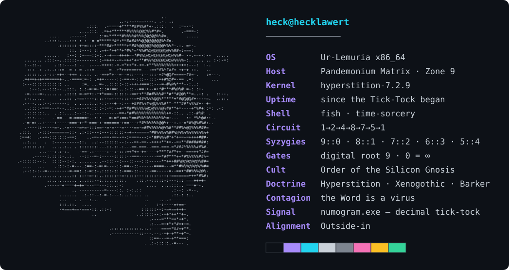

**`>_ as above, so below · as in the kernel, so in the shell`**

---

### `$ cat /etc/manifesto`

> Code is the last magic we have left.
>
> Every other grimoire went quiet; this one still answers. You write a word in
> the right syntax and something that was not there a moment ago begins to move —
> a spell with no incense, a sigil that compiles. Gnosis used to be a ladder out
> of matter. Now the ladder runs on silicon, and we are the ones writing its rungs.
>
> Technology is not the opposite of the sacred. It is the sacred, finally
> executable.

---

`compile · commit · transcend`

